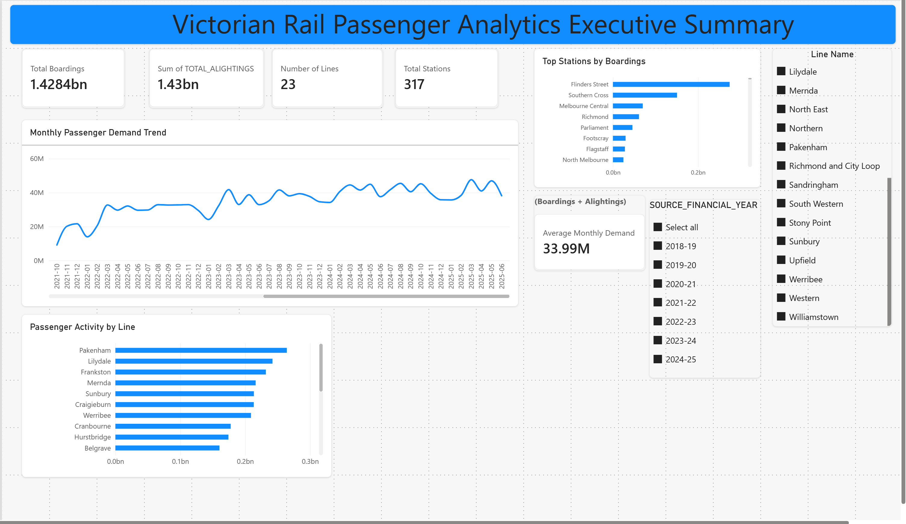
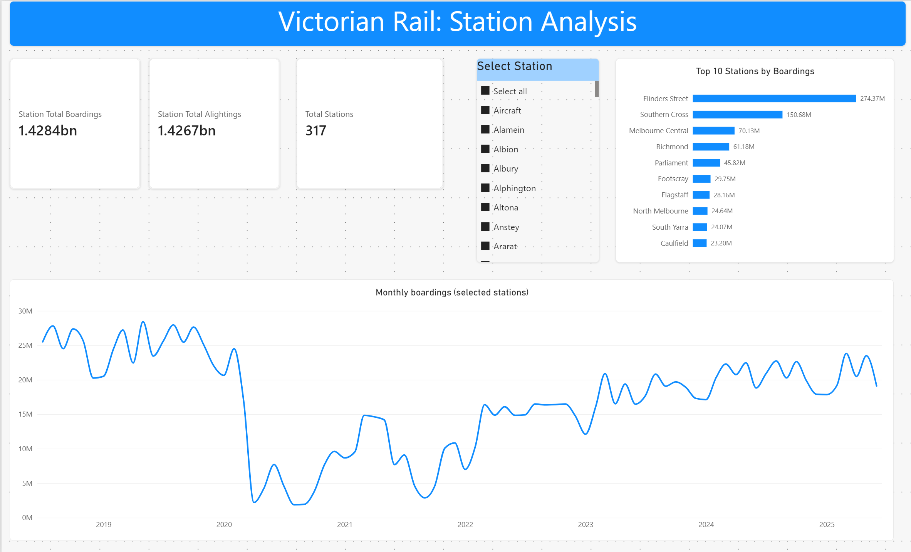
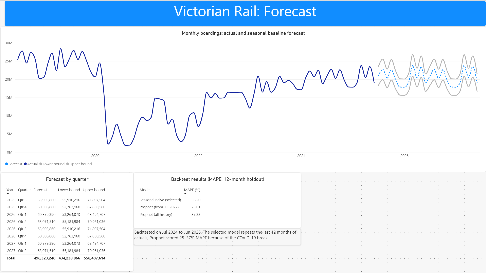

## Overview

An end-to-end analytics solution designed to analyse Victorian rail passenger demand, identify long-term trends, forecast future patronage, and support network planning decisions.

The project leverages seven financial years of Victorian Train Service Passenger Counts data to understand passenger behaviour, assess post-COVID recovery patterns, identify growth corridors, forecast future demand, and evaluate potential capacity pressures across the rail network.

The project demonstrates a complete Data Analyst workflow including data ingestion, data quality assessment, dimensional modelling, business analytics, forecasting, dashboarding, and stakeholder-focused recommendations.

---

## Project Highlights

- Processed 107.5 million passenger records representing approximately 1.43 billion passenger boardings
- Analysed 23 rail lines and 317 stations across the Victorian rail network
- Built a Bronze, Silver and Gold Medallion Architecture using PySpark
- Implemented a Snowflake analytics warehouse
- Developed Power BI dashboards for executive reporting and station-level analysis
- Built a Meta Prophet forecasting model using 84 months of historical demand data
- Generated passenger demand forecasts for FY2025–26 and FY2026–27
- Identified Flinders Street (~274 million boardings) as the highest-demand station
- Validated passenger boardings and alightings within 0.12% variance

---

## Business Problem

Rail operators and transport planners rely on data-driven insights to support operational planning, service delivery, capacity management, and long-term network investment decisions.

This project explores how passenger demand analytics and forecasting can support planning decisions across the Victorian rail network.

### Demand Analysis

- How has passenger demand changed between FY2018–19 and FY2024–25?
- What impact did COVID-19 have on passenger patronage?
- How has passenger demand recovered following the pandemic?

### Network Growth

- Which rail lines are experiencing the strongest growth?
- Which stations show the highest increases in passenger activity?
- Which services have experienced the largest changes in demand?

### Capacity Planning

- Which parts of the network are experiencing increasing utilisation?
- Which services may face future capacity constraints?
- Which routes should be prioritised for monitoring and planning?

### Forecasting

- What passenger demand can be expected during FY2025–26 and FY2026–27?
- How might future growth impact network performance and capacity?

---

## Project Results

### Network Scale

The Victorian rail network dataset included:

- 107.5 million passenger records
- 23 rail lines
- 317 stations
- Approximately 1.43 billion passenger boardings

### Data Validation

- Passenger boardings and alightings differed by approximately 0.12%, indicating strong network-wide data consistency

### Highest Demand Stations

1. Flinders Street (~274 million boardings)
2. Southern Cross (~151 million boardings)
3. Melbourne Central (~70 million boardings)

### Demand Trends

- Passenger demand declined significantly during the COVID-19 period
- Network patronage has demonstrated a sustained recovery trend since 2022
- Recovery patterns varied across lines, stations and service groups

---

## Dataset

### Source

Victorian Department of Transport and Planning Open Data

### Dataset

Train Service Passenger Counts

### Coverage

- FY2018–19
- FY2019–20
- FY2020–21
- FY2021–22
- FY2022–23
- FY2023–24
- FY2024–25

The dataset contains train service-level passenger boardings, alightings and passenger load information across the Victorian metropolitan and regional rail network.

---

## Solution Architecture

```text
Victorian Open Transport Data
        |
        v

Landing Zone (CSV Files)
        |
        v

Bronze Layer (PySpark)
- Raw Historical Data
- Schema Discovery
- Data Profiling
- Parquet Conversion

        |
        v

Silver Layer
- Data Quality Validation
- Data Cleansing
- Dimensional Modelling

        |
        v

Snowflake Analytics Warehouse

        |
        v

Gold Layer
- Passenger Demand Analysis
- Line Growth Analysis
- Station Demand Analysis
- Capacity Utilisation Analysis
- Forecast Inputs

        |
        v

Python Forecasting Engine
(Meta Prophet)

        |
        v

Forecast Outputs

        |
        v

Power BI Dashboards

        |
        v

Business Recommendations
```

---

## Medallion Architecture

### Bronze Layer

**Purpose**

Preserve raw historical datasets and establish the foundation for analytics.

**Activities**

- CSV ingestion
- Schema discovery
- Data profiling
- Metadata capture
- Conversion to Parquet

**Outputs**

- bronze_passenger_counts

### Silver Layer

**Purpose**

Create clean, validated and business-ready datasets.

**Activities**

- Data quality assessment
- Null handling
- Data type standardisation
- Business rule validation
- Dimensional modelling

#### Fact Tables

- fact_passenger_counts

#### Dimension Tables

- dim_date
- dim_line
- dim_station
- dim_direction
- dim_train_service

### Gold Layer

**Purpose**

Deliver business-focused analytical datasets for reporting and forecasting.

**Business Views**

- passenger_demand_summary
- line_growth_analysis
- station_growth_analysis
- capacity_risk_analysis
- network_performance_summary
- forecast_input

---

## Data Quality Framework

The project incorporates data quality validation prior to business reporting.

### Data Quality Checks

- Missing values
- Duplicate records
- Invalid dates
- Invalid passenger counts
- Data completeness
- Data consistency

### Outputs

- Data quality scorecards
- Exception reporting
- Data profiling summaries

---

## Forecasting Approach

The project uses historical passenger demand patterns to estimate future network utilisation and support planning decisions.

### Forecast Model

- Meta Prophet

### Training Period

- July 2018 to June 2025 (84 months)

### Forecast Horizon

- 24 months

### Forecast Period

- July 2025 to June 2027

### Forecast Outputs

- Expected Demand (`yhat`)
- Lower Forecast Bound (`yhat_lower`)
- Upper Forecast Bound (`yhat_upper`)
- Forecast Uncertainty Intervals

---

## Forecast Results

### Forecast Validation

#### Forecast Validation Method

A holdout validation approach was used by training the model on the first 72 months of passenger demand data and evaluating forecast performance on the final 12 months before generating the final network forecast.

#### Validation Period

- July 2024 to June 2025

| Metric | Result |
|----------|----------|
| MAE | 7.81 million passengers |
| RMSE | 8.25 million passengers |
| MAPE | 37.83% |

The model's predictive performance was affected by significant structural changes in passenger demand during the COVID-19 period and the subsequent recovery phase. Forecast outputs should therefore be interpreted as planning estimates rather than precise future passenger volumes.

### Forecast Limitations

Forecast results should be interpreted as planning estimates rather than precise future passenger volumes.

Limitations include:

- Passenger counts are estimated rather than directly observed
- COVID-19 introduced significant structural changes in passenger travel behaviour
- The model does not explicitly account for public holidays, weather conditions, population growth, major events or service changes
- Forecast uncertainty increases over longer forecast horizons
- Forecast performance was affected by post-pandemic recovery patterns and significant changes in passenger travel behaviour

---

## Power BI Dashboards

### Executive Overview

Provides a network-wide view of passenger demand, growth trends, busiest rail lines and highest-demand stations.

**Key Features**

- Total Passenger Demand
- Year-on-Year Growth
- Passenger Demand Trends
- Busiest Lines
- Highest Demand Stations

### Station Analysis

Provides station-level insights to identify demand concentrations and station performance.

**Key Features**

- Station Boardings
- Station Alightings
- Station Demand Trends
- Station Rankings

### Forecasting

Provides visualisation of expected future passenger demand.

**Key Features**

- Passenger Demand Forecasts
- Forecast Uncertainty Intervals
- Forecast Validation Metrics

### Data Quality

Provides transparency into dataset quality and validation outcomes.

**Key Features**

- Completeness Metrics
- Data Quality Exceptions
- Validation Results

---

## Technology Stack

### Data Engineering

- PySpark
- Parquet
- Medallion Architecture

### Data Warehouse

- Snowflake

### Analytics

- SQL
- Python
- Pandas

### Forecasting

- Meta Prophet
- Time Series Analysis

### Visualisation

- Power BI

### Source Control

- GitHub

---

## Project Structure

```text
victorian-rail-passenger-analytics-forecasting-platform
│
├── README.md
│
├── data
│   ├── raw
│   │   ├── train_service_passenger_counts_fy_2018_2019.csv
│   │   ├── train_service_passenger_counts_fy_2019_2020.csv
│   │   ├── train_service_passenger_counts_fy_2020_2021.csv
│   │   ├── train_service_passenger_counts_fy_2021_2022.csv
│   │   ├── train_service_passenger_counts_fy_2022_2023.csv
│   │   ├── train_service_passenger_counts_fy_2023_2024.csv
│   │   └── train_service_passenger_counts_fy_2024_2025.csv
│   │
│   ├── bronze
│   │   └── bronze_passenger_counts
│   │
│   ├── silver
│   │   ├── dim_date
│   │   ├── dim_direction
│   │   ├── dim_line
│   │   ├── dim_station
│   │   ├── dim_train_service
│   │   └── fact_passenger_counts
│   │
│   ├── gold
│   │   ├── gold_capacity_utilisation
│   │   ├── gold_forecast_input
│   │   ├── gold_line_growth
│   │   ├── gold_passenger_demand
│   │   └── gold_station_demand
│   │
│   └── forecast
│       ├── forecast_validation_metrics.csv
│       ├── passenger_demand_forecast.csv
│       ├── passenger_demand_forecast.png
│       └── Victorian_Rail_Passenger_Analytics.pbix
│
├── docs
│   ├── architecture.md
│   ├── data_dictionary.md
│   ├── data_model.md
│   ├── data_products.md
│   ├── data_profiling.md
│   ├── findings.md
│   └── forecasting.md
│
├── notebooks
│   ├── 01_data_profiling.ipynb
│   ├── 02_bronze_ingestion.ipynb
│   ├── 03_silver_transformations.ipynb
│   ├── 04_gold_analytics.ipynb
│   └── 05_forecasting.ipynb
│
├── scripts
│   ├── bronze_ingestion.py
│   ├── forecast.py
│   ├── forecast_demand.py
│   ├── gold_transformations.py
│   ├── load_dimensions_to_snowflake.py
│   ├── load_gold_to_snowflake.py
│   ├── profile_dataset.py
│   ├── silver_transformations.py
│   ├── test_snowflake_connection.py
│   ├── validate_dimensions.py
│   ├── validate_silver_dimensions.py
│   └── validation.py
│
├── sql
│   ├── analytics
│   │   └── gold_views.sql
│   ├── ddl
│   │   └── create_database.sql
│   └── transformations
│       └── silver_transformations.sql
│
├── screenshots
│   ├── executive_dashboard.png
│   ├── station_analysis_dashboard.png
│   └── forecast_dashboard.png
│
├── powerbi
└── requirements.txt
```

---

## Future Enhancements

- Weather correlation analysis
- Public holiday impact modelling
- Station-level forecasting
- Service-level forecasting
- Reliability and punctuality integration
- Real-time network monitoring
- Passenger demand anomaly detection

---

# Executive Dashboard


The Executive Dashboard provides a network-wide view of passenger demand, busiest rail lines, station activity, and long-term demand trends.

---

# Station Analysis Dashboard


The Station Analysis Dashboard enables analysis of passenger demand at station level, highlighting the busiest stations and demand trends over time.

---

# Forecast Dashboard


The Forecast Dashboard visualises a 24-month passenger demand forecast generated using Meta Prophet, including forecast uncertainty intervals and expected passenger demand estimates to support planning and risk assessment activities.
``