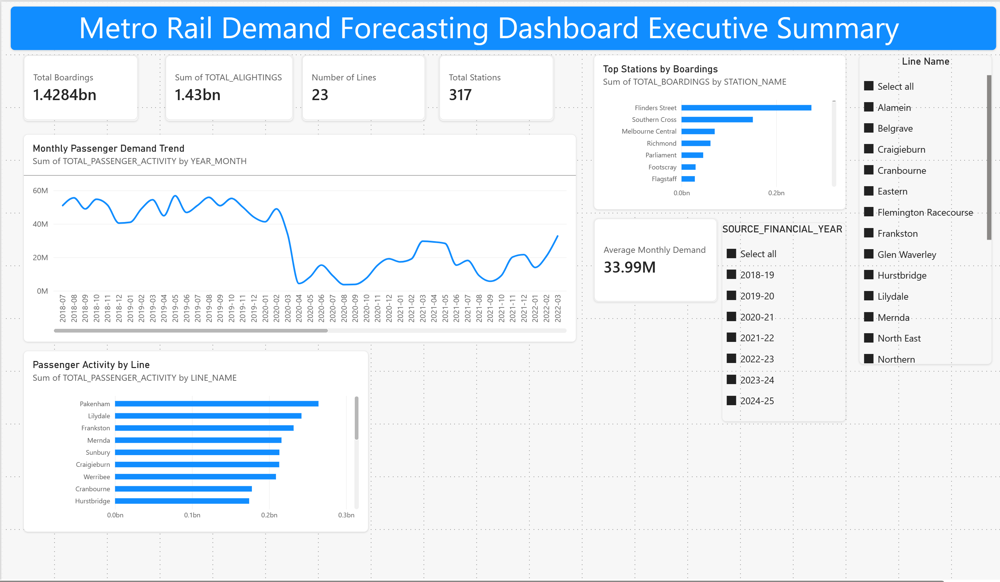
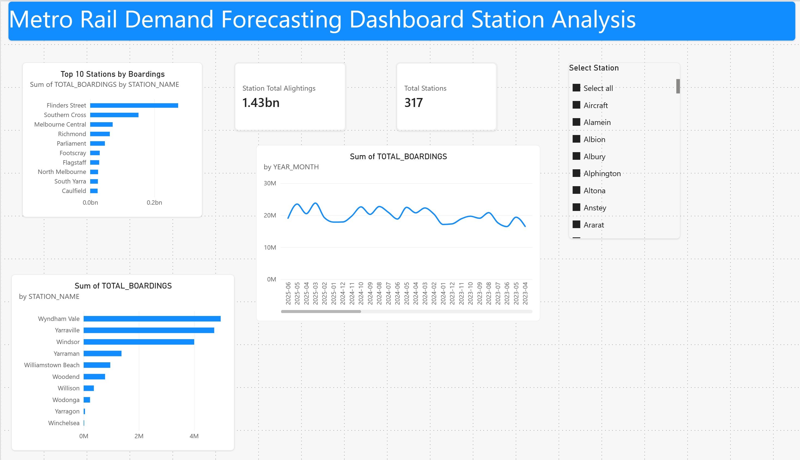
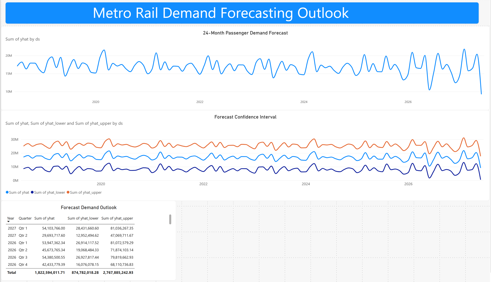

# Victorian Rail Passenger Analytics & Forecasting Platform

## Overview

An end-to-end analytics solution designed to analyse Victorian rail passenger demand, identify long-term trends, forecast future patronage, and support network planning decisions.

The project leverages seven financial years of Victorian train service passenger count data to understand passenger behaviour, assess post-COVID recovery patterns, identify growth corridors, forecast future demand, and evaluate potential capacity pressures across the rail network.

This project demonstrates a complete Data Analyst workflow including data ingestion, data quality assessment, dimensional modelling, business analytics, forecasting, dashboarding, and stakeholder-focused recommendations.

## Project Highlights

- Processed 107.5 million passenger records
- Analysed 23 rail lines and 317 stations
- Built a Bronze, Silver and Gold Medallion Architecture
- Implemented a Snowflake analytics warehouse
- Developed Power BI dashboards for executive reporting and station analysis
- Built a Meta Prophet forecasting model using 84 months of historical demand
- Generated a 24-month passenger demand forecast through May 2027
- Identified Flinders Street (~274M boardings) as the highest-demand station
- Validated passenger boardings and alightings within 0.12% variance

---

## Business Problem

Rail operators and transport planners rely on data-driven insights to support operational planning, service delivery and long-term network investment decisions.

This project explores how passenger demand analytics and forecasting can support planning decisions across the Victorian rail network.

This project seeks to answer the following questions:

## Project Results

### Network Scale

- Processed 107.5 million passenger records.
- Analysed 23 rail lines.
- Analysed 317 stations.
- Processed approximately 1.43 billion passenger boardings.

### Data Validation

- Passenger boardings and alightings differed by approximately 0.12%, indicating strong network-wide data consistency.

### Highest Demand Stations

1. Flinders Street (~274M boardings)
2. Southern Cross (~151M boardings)
3. Melbourne Central (~70M boardings)

### Forecasting

- Developed a Prophet forecasting model using 84 months of historical demand.
- Generated a 24-month passenger demand forecast through May 2027.
- Produced forecast uncertainty intervals (upper and lower bounds) to support planning and risk assessment.

### Demand Analysis

- How has passenger demand changed between FY2018-19 and FY2024-25?
- What impact did COVID-19 have on passenger patronage?
- How has passenger demand recovered following the pandemic?

### Network Growth

- Which rail lines are experiencing the strongest growth?
- Which stations show the highest increases in passenger activity?
- Which services have experienced the largest changes in demand?

### Capacity Planning

- Which parts of the network are experiencing increasing utilisation?
- Which services may face future capacity constraints?
- Which routes should be prioritised for monitoring and planning?

### Forecasting

- What passenger demand can be expected during FY2025-26 and FY2026-27?
- How might future growth impact network performance and capacity?

---

## Dataset

Source:

Victorian Department of Transport and Planning Open Data

Dataset:

Train Service Passenger Counts

Coverage:

- FY2018-19
- FY2019-20
- FY2020-21
- FY2021-22
- FY2022-23
- FY2023-24
- FY2024-25

The dataset contains train service-level passenger boardings, alightings and passenger load information across the Victorian metropolitan and regional rail network.

---

## Solution Architecture

```text
Victorian Open Transport Data
         |
         v

Landing Zone (CSV Files)
         |
         v

Bronze Layer (PySpark)
Raw Historical Data
Schema Discovery
Data Profiling
Parquet Conversion
         |
         v

Silver Layer
Data Quality Validation
Data Cleansing
Dimensional Modelling
         |
         v

Snowflake Analytics Warehouse
         |
         v

Gold Layer
Business Data Products
Growth Analysis
Capacity Analysis
Forecast Inputs
         |
         v

Python Forecasting Engine
Prophet
Moving Average Models
         |
         v

Forecast Results
         |
         v

Power BI Dashboards
         |
         v

Business Recommendations
```

---

## Medallion Architecture

### Bronze Layer

Purpose:

Preserve raw historical datasets and establish the foundation for analytics.

Activities:

- CSV ingestion
- Schema discovery
- Data profiling
- Metadata capture
- Conversion to Parquet

Outputs:

- bronze_passenger_counts

---

### Silver Layer

Purpose:

Create clean, validated and business-ready datasets.

Activities:

- Data quality assessment
- Null handling
- Data type standardisation
- Business rule validation
- Dimensional modelling

Fact Tables:

- fact_passenger_counts

Dimension Tables:

- dim_date
- dim_line
- dim_direction

---

### Gold Layer

Purpose:

Deliver business-focused analytical datasets for reporting and forecasting.

Business Views:

- passenger_demand_summary
- line_growth_analysis
- station_growth_analysis
- capacity_risk_analysis
- network_performance_summary
- forecast_input

---

## Data Quality Framework

The project incorporates data quality validation prior to business reporting.

Checks include:

- Missing values
- Duplicate records
- Invalid dates
- Invalid passenger counts
- Data completeness
- Data consistency

Outputs:

- Data quality scorecards
- Exception reporting
- Data profiling summaries

---

## Forecasting Approach

The project uses historical passenger demand patterns to estimate future network utilisation.

### Forecast Model

- Meta Prophet

Training Data:
- July 2018 to June 2025 (84 months)

Forecast Horizon:
- 24 months

Forecast Period:
- July 2025 to June 2027

### Forecast Horizons

- FY2025-26
- FY2026-27

### Forecast Outputs

- Network Passenger Demand

---

## Power BI Dashboards

### Executive Overview

- Total Passenger Demand
- Year-on-Year Growth
- Forecast Passenger Demand
- High Growth Corridors

### Passenger Demand Analysis

- Historical Demand Trends
- COVID Impact Analysis
- Recovery Patterns

### Growth Analysis

- Fastest Growing Lines
- Fastest Growing Stations
- Growth Rankings

### Capacity Planning

- Capacity Risk Assessment
- Service Utilisation Analysis
- Network Pressure Points

### Forecasting

- Passenger Demand Forecasts
- Confidence Intervals
- Forecast Uncertainty Analysis

### Data Quality

- Completeness Metrics
- Data Quality Exceptions
- Validation Results

---

## Key Findings

### Network Demand

- Approx. 1.43 billion passenger boardings were analysed.

### Data Validation

- Passenger boardings and alightings differed by only 0.12%, indicating strong dataset consistency.

### Highest Demand Stations

1. Flinders Street (~274M boardings)
2. Southern Cross (~151M boardings)
3. Melbourne Central (~70M boardings)

### Demand Trends

- Passenger demand declined significantly during the COVID-19 period before demonstrating a sustained recovery trend from 2022 onwards.

### Forecast

- A 24-month passenger demand forecast was generated through May 2027 using Meta Prophet.

---
## Technology Stack

### Data Engineering

- PySpark
- Parquet
- Medallion Architecture

### Snowflake Warehouse
The Gold analytical datasets and dimensional model were loaded into Snowflake to support reporting and downstream analytics.

Dimensions:

- DIM_DATE
- DIM_LINE
- DIM_STATION
- DIM_DIRECTION
- DIM_TRAIN_SERVICE

Analytics Tables:

- GOLD_PASSENGER_DEMAND
- GOLD_STATION_DEMAND
- GOLD_LINE_GROWTH
- GOLD_CAPACITY_UTILISATION
- GOLD_FORECAST_INPUT

### Analytics

- SQL
- Python
- Pandas (profiling and exploratory analysis)

### Forecasting

- Prophet
- Time-Series Analysis

## Forecast Results

Model:
- Meta Prophet

Training Data:
- 84 months

Forecast Horizon:
- 24 months

Forecast End Date:
- 31 May 2027

Outputs:

- Expected Demand (yhat)
- Lower Forecast Bound (yhat_lower)
- Upper Forecast Bound (yhat_upper)

### Reporting

- Power BI

### Source Control

- GitHub

---

## Project Structure

```text
victorian-rail-passenger-analytics-platform

├── README.md

├── data
│   ├── raw
│   ├── bronze
│   ├── silver
│   └── gold

├── docs
│   ├── architecture.md
│   ├── business_problem.md
│   ├── data_dictionary.md
│   ├── data_model.md
│   └── data_profiling.md

├── notebooks
│   ├── 01_bronze_ingestion.ipynb
│   ├── 02_data_profiling.ipynb
│   ├── 03_silver_transformation.ipynb
│   ├── 04_gold_analytics.ipynb
│   └── 05_forecasting.ipynb

├── sql
│   ├── create_tables.sql
│   ├── transformations.sql
│   └── analytics.sql

├── powerbi

├── screenshots

└── requirements.txt
```

---

## Key Outcomes

This project demonstrates:

- End-to-End Data Analytics
- Data Quality Management
- Data Modelling
- SQL Analytics
- Trend Analysis
- Forecasting & Modelling
- Capacity Planning
- Snowflake Analytics
- Python Analytics
- Power BI Development
- Data Storytelling
- Business Recommendations
- Decision Support

---

## Future Enhancements

- Weather correlation analysis
- Public holiday impact modelling
- Station-level forecasting
- Service-level forecasting
- Reliability and punctuality integration
- Real-time network monitoring
- Passenger demand anomaly detection


# Executive Dashboard

The Executive Dashboard provides a network-wide view of passenger demand, busiest rail lines, station activity and long-term demand trends.

---

# Station Analysis Dashboard

The Station Analysis dashboard enables analysis of passenger demand at station level, highlighting the busiest stations and demand trends over time.

---

# Forecast Dashboard


The Forecast Dashboard visualises a 24-month passenger demand forecast generated using Meta Prophet, including forecast confidence intervals and expected demand scenarios.